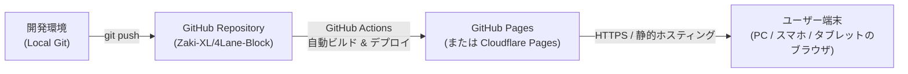
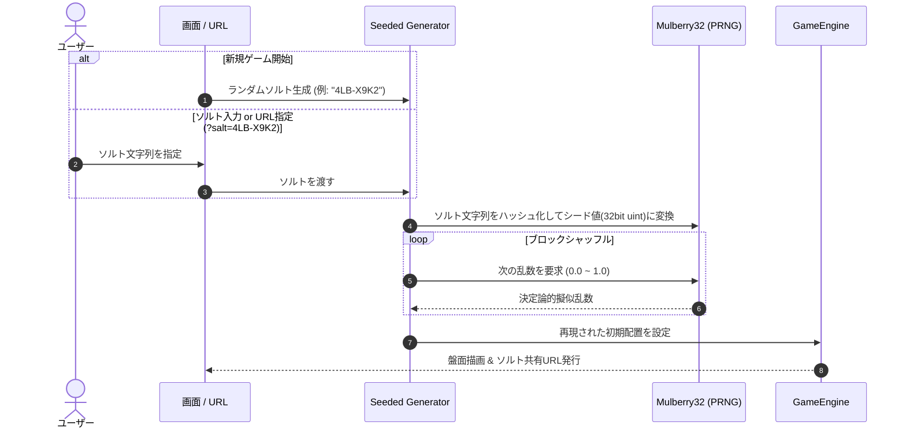

# 4Lane Block システム・アーキテクチャ設計書

本ドキュメントは、「4Lane Block」のシステム設計、公開基盤、操作API抽象化レイヤー、およびソルトによる盤面再現アルゴリズムを定義します。

---

## 1. ホスティング・公開アーキテクチャ (無料ブラウザ公開)

完全無料かつメンテナンスフリーでブラウザ向けに公開するためのアーキテクチャ構成です。



### 1.1 公開プラットフォームの選定
| プラットフォーム | 費用 | 特徴・メリット | 評価 |
| :--- | :--- | :--- | :--- |
| **GitHub Pages** | **完全無料** | Gitリポジトリ直結。GitHub Actionsで自動ビルド＆デプロイ可能。カスタムドメイン・SSL無料。 | **推奨 (第1候補)** |
| **Cloudflare Pages** | **完全無料** | 帯域幅無制限、世界最速水準のエッジCDN配信、Git連携ビルド。 | **推奨 (第2候補)** |
| **Netlify / Vercel** | 無料枠あり | 多機能だが商用利用や転送量制限の確認が必要。 | 代替候補 |

- **結論**: 本リポジトリがすでに Git 管理されているため、最も追加インフラ設定が不要で運用コストゼロの **GitHub Pages**（または Cloudflare Pages）での静的Web配信を採用します。
- **実行環境**: 完全クライアントサイド（HTML5 / TypeScript / CSS）。バックエンドサーバー不要で動作します。

---

## 2. レイヤード・アーキテクチャ (操作APIの抽象化)

ゲームのコアロジックをUIや入力デバイスから完全に疎結合化（分離）し、APIとしてカプセル化します。

```mermaid
graph TD
    subgraph InputLayer ["入力抽象化レイヤー (Input Controllers)"]
        ClickCtrl["Click / Tap Controller<br/>(クリック・タップ操作)"]
        DragCtrl["Drag & Drop Controller<br/>(ドラッグ＆ドロップ)"]
        KeyCtrl["Keyboard Controller<br/>(1~4キー, 矢印キー)"]
        AutoSolver["(将来拡張) AI Solver / Replayer"]
    end

    subgraph CoreLayer ["コア・ゲームエンジン (Core API)"]
        API["GameEngine API<br/>(pick, drop, move, cancel, reset, loadSalt)"]
        StateMgr["State Manager<br/>(スタック管理, 高さ検証, 勝利判定)"]
        PRNG["Seeded PRNG<br/>(ソルト駆動 盤面生成器)"]
    end

    subgraph ViewLayer ["プレゼンテーション層 (View / Renderer)"]
        Renderer["DOM / Canvas Renderer<br/>(ブロック描画, アニメーション)"]
        Sound["Audio Manager<br/>(効果音, BGM)"]
    end

    InputLayer -->|API呼び出し| API
    API --> StateMgr
    StateMgr --> PRNG
    StateMgr -->|状態変化イベント (stateChange)| Renderer
    StateMgr -->|クリアイベント (gameClear)| Sound
```

### 2.1 コア操作 API インターフェース (`IGameEngine`)
すべての入力方式は、以下の共通インターフェースを経由してのみ盤面を操作します。

```typescript
export interface IGameEngine {
  // 状態取得
  getState(): Readonly<GameState>;
  
  // 基本アクション (2ステップ操作)
  canPick(laneIndex: number): boolean;
  pick(laneIndex: number): boolean;
  
  canDrop(laneIndex: number): boolean;
  drop(laneIndex: number): boolean;
  
  cancelPick(): void;

  // 一括移動アクション (1ステップ操作: ドラッグ&ドロップや自動解法用)
  canMove(fromIndex: number, toIndex: number): boolean;
  move(fromIndex: number, toIndex: number): boolean;

  // ゲーム制御・盤面再現
  reset(): void;
  loadFromSalt(salt: string): void;
  getCurrentSalt(): string;

  // イベント購読
  on(event: 'stateChange', listener: (state: GameState) => void): void;
  on(event: 'moveSuccess', listener: (move: { from: number; to: number; block: Block }) => void): void;
  on(event: 'invalidMove', listener: (reason: string) => void): void;
  on(event: 'gameClear', listener: (result: { moveCount: number; elapsedTime: number }) => void): void;
}
```

### 2.2 入力コントローラーの実装方式
各入力コントローラーは `IGameEngine` のインスタンスを受け取り、ユーザーの入力を API 呼び出しに変換します。

1. **`ClickInputController`**:
   - 1回目のレーンクリック: `engine.canPick(i)` $\to$ `engine.pick(i)`
   - 2回目のレーンクリック:
     - 同一レーンなら `engine.cancelPick()`
     - 別レーンなら `engine.canDrop(j)` $\to$ `engine.drop(j)`
2. **`DragDropInputController`**:
   - ブロック掴み開始 (PointerDown): 対象レーンの最上部ブロックを判定
   - ドロップ時 (PointerUp): ドロップ先レーン判定 $\to$ `engine.move(fromIndex, toIndex)`
3. **`KeyboardInputController`**:
   - レーン選択ショートカット: `[1]`, `[2]`, `[3]`, `[4]` キー
   - カーソル移動ショートカット: `[←] / [→]` でフォーカス移動、`[Space] / [Enter]` で選択・決定、`[Esc]` でキャンセル

---

## 3. ソルトによる盤面再現性 (Deterministic Seeded PRNG)

ゲーム開始時にランダムな「ソルト（シード文字列）」を発行し、ソルトから擬似乱数列を生成することで、**同一ソルトであれば誰でも全く同じ初期盤面を再現**できます。



### 3.1 ソルト仕様
- **フォーマット**: 読みやすく入力しやすい英数字（例: `4LB-7A9X` または 8文字のBase36/Hex）。
- **シード変換**: ソルト文字列から 32-bit 整数のシード値を算出（FNV-1a または MurmurHash3）。
- **乱数アルゴリズム**: **Mulberry32**（実装が32-bitシフトのみで極めて軽量、高速、かつブラウザ環境に依存せず完全同一の出力を保証）。
- **共有機能**:
  - Web画面上に現在の「盤面コード（ソルト）」を常時表示・ワンクリックコピーボタンを設置。
  - URLクエリパラメータ連動: `https://<domain>/?salt=4LB-7A9X` でアクセスすると、その盤面が自動ロードされる。
