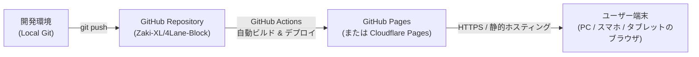

# 4Lane Block システム・アーキテクチャ設計書

本ドキュメントは、「4Lane Block」のシステム設計、公開基盤、操作API抽象化レイヤー、およびソルトによる盤面再現アルゴリズムを定義します。

---

## 1. ホスティング・公開アーキテクチャ (無料ブラウザ公開)

完全無料かつメンテナンスフリーでブラウザ向けに公開するためのアーキテクチャ構成です。



### 1.1 公開プラットフォームの選定
| プラットフォーム | 費用 | 特徴・メリット | 評価 |
| :--- | :--- | :--- | :--- |
| **GitHub Pages** | **完全無料** | Gitリポジトリ直結。GitHub Actionsで自動ビルド＆デプロイ可能。カスタムドメイン・SSL無料。 | **推奨 (第1候補)** |
| **Cloudflare Pages** | **完全無料** | 帯域幅無制限、世界最速水準のエッジCDN配信、Git連携ビルド。 | **推奨 (第2候補)** |
| **Netlify / Vercel** | 無料枠あり | 多機能だが商用利用や転送量制限の確認が必要。 | 代替候補 |

- **結論**: 本リポジトリがすでに Git 管理されているため、最も追加インフラ設定が不要で運用コストゼロの **GitHub Pages**（または Cloudflare Pages）での静的Web配信を採用します。
- **実行環境**: 完全クライアントサイド（HTML5 / TypeScript / CSS）。バックエンドサーバー不要で動作します。

---

## 2. レイヤード・アーキテクチャ (操作APIの抽象化)

ゲームのコアロジックをUIや入力デバイスから完全に疎結合化（分離）し、APIとしてカプセル化します。

```mermaid
graph TD
    subgraph InputLayer ["入力抽象化レイヤー (Input Controllers)"]
        ClickCtrl["Click / Tap Controller<br/>(クリック・タップ操作)"]
        DragCtrl["Drag & Drop Controller<br/>(ドラッグ＆ドロップ)"]
        KeyCtrl["Keyboard Controller<br/>(1~4キー, 矢印キー)"]
        AutoSolver["(将来拡張) AI Solver / Replayer"]
    end

    subgraph CoreLayer ["コア・ゲームエンジン (Core API)"]
        API["GameEngine API<br/>(start, pick, drop, move, cancel, reset, loadSalt)"]
        StateMgr["State Manager<br/>(スタック管理, 高さ検証, 勝利判定)"]
        TimerMgr["Timer Manager<br/>(高精度カウントアップ計測)"]
        PRNG["Seeded PRNG<br/>(ソルト駆動 盤面生成器)"]
    end

    subgraph ViewLayer ["プレゼンテーション層 (View / Renderer)"]
        Renderer["DOM / Canvas Renderer<br/>(ブロック描画, タイマーUI表示, アニメーション)"]
        Sound["Audio Manager<br/>(効果音, BGM)"]
    end

    InputLayer -->|API呼び出し| API
    API --> StateMgr
    StateMgr --> TimerMgr
    StateMgr --> PRNG
    StateMgr -->|状態変化イベント (stateChange)| Renderer
    TimerMgr -->|毎フレーム経過時間 (timerTick)| Renderer
    StateMgr -->|クリアイベント (gameClear)| Sound
```

### 2.1 コア操作 API インターフェース (`IGameEngine`)
すべての入力方式は、以下の共通インターフェースを経由してのみ盤面を操作します。

```typescript
export interface IGameEngine {
  // 状態取得
  getState(): Readonly<GameState>;
  
  // 基本アクション (2ステップ操作)
  canPick(laneIndex: number): boolean;
  pick(laneIndex: number): boolean;
  
  canDrop(laneIndex: number): boolean;
  drop(laneIndex: number): boolean;
  
  cancelPick(): void;

  // 一括移動アクション (1ステップ操作: ドラッグ&ドロップや自動解法用)
  canMove(fromIndex: number, toIndex: number): boolean;
  move(fromIndex: number, toIndex: number): boolean;

  // ゲーム制御・盤面再現・タイマー
  start(): void; // ゲーム開始 (カウントアップタイマー起動)
  reset(): void; // リトライ (タイマー初期化)
  loadFromSalt(salt: string): void;
  getCurrentSalt(): string;

  // イベント購読
  on(event: 'stateChange', listener: (state: GameState) => void): void;
  on(event: 'timerTick', listener: (elapsedTime: number) => void): void;
  on(event: 'moveSuccess', listener: (move: { from: number; to: number; block: Block }) => void): void;
  on(event: 'invalidMove', listener: (reason: string) => void): void;
  on(event: 'gameClear', listener: (result: { moveCount: number; elapsedTime: number; salt: string }) => void): void;
}
```

### 2.2 入力コントローラーの実装方式
各入力コントローラーは `IGameEngine` のインスタンスを受け取り、ユーザーの入力を API 呼び出しに変換します。

1. **`ClickInputController`**:
   - 1回目のレーンクリック: `engine.canPick(i)` $\to$ `engine.pick(i)`
   - 2回目のレーンクリック:
     - 同一レーンなら `engine.cancelPick()`
     - 別レーンなら `engine.canDrop(j)` $\to$ `engine.drop(j)`
2. **`DragDropInputController`**:
   - ブロック掴み開始 (PointerDown): 対象レーンの最上部ブロックを判定
   - ドロップ時 (PointerUp): ドロップ先レーン判定 $\to$ `engine.move(fromIndex, toIndex)`
3. **`KeyboardInputController`**:
   - レーン選択ショートカット: `[1]`, `[2]`, `[3]`, `[4]` キー
   - カーソル移動ショートカット: `[←] / [→]` でフォーカス移動、`[Space] / [Enter]` で選択・決定、`[Esc]` でキャンセル

---

## 3. 難読化ソルトによる盤面再現性 (Obfuscated Deterministic PRNG)

ゲーム開始時に発行されるソルトは、外部から構造（高さや乱数シード）が読み取れないよう暗号的にスクランブルされた8桁の英数字（例: `K8X2-9M4B`）となります。

```mermaid
graph LR
    subgraph エンコード (発行)
        Data["高さ(H) + 乱数シード + 検証値"] -->|40-bitパック| Pack["Raw 40-bit Data"]
        Pack -->|XORマスク & 可逆アフィン変換| Scramble["難読化 40-bit値 (雪崩効果)"]
        Scramble -->|Base32変換| Code["8桁コード (例: K8X2-9M4B)"]
    end

    subgraph デコード (復元)
        Code -->|Base32デコード| DeScramble["難読化値"]
        DeScramble -->|逆アフィン変換 & 逆XOR| Unpack["Raw 40-bit Data"]
        Unpack -->|チェックサム検証 & 分解| Restore["高さ(H) & 盤面完全復元"]
    end
```

### 3.1 難読化ソルトの技術仕様
- **フォーマット**: 誤認しやすい `0, 1, I, O` を除外した英数字8文字（4文字-4文字ハイフン表記: `XXXX-XXXX`）。
- **データ構造**: 高さ $H$（4-bit: 3〜15） + 乱数シード（26-bit） + エントロピー（5-bit） + チェックサム（5-bit） = 計 40-bit。
- **暗号置換**:
  - $2^{40}$ を法とする可逆アフィン暗号変換: $C = (x \times M + A) \pmod{2^{40}}$ （乗算逆元 $M^{-1}$ による完全復元）。
  - マジックXORマスクとビット撹拌により、高さが1違うだけでコード全体が激変する雪崩効果（アバランシェ効果）を実現。
- **共有機能**:
  - Web画面上の「SALT」欄に表示、ワンクリックコピー可能。
  - URLクエリパラメータ連動: `https://<domain>/?salt=K8X2-9M4B` でアクセスすると、設定された高さと配置が完全再現される。

---

## 4. ビューポート動的スケーリング (1画面フィット設計)

高さ $H$ が10段や15段になっても、縦スクロールが発生せず1画面（`100dvh`）内に常に収まるように動的スケーリングを行います。

1. **利用可能領域の動的計算**:
   - `availableHeight = window.innerHeight - (ヘッダー + コントロールパネル + 操作説明 + 余白)`
2. **スロット高さの最適化**:
   - `slotHeight = clamp(16px, floor((availableHeight - gapTotal) / heightLimit), 52px)`
   - CSS変数 `--slot-height`, `--block-font-size`, `--height-limit` をルート要素へ動的注入。
3. **リサイズ追従**:
   - `window.resize` イベントを購読し、ウィンドウサイズ変更時にもリアルタイムで再計算・追従。

