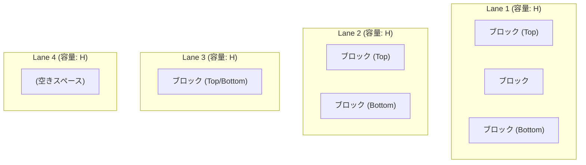
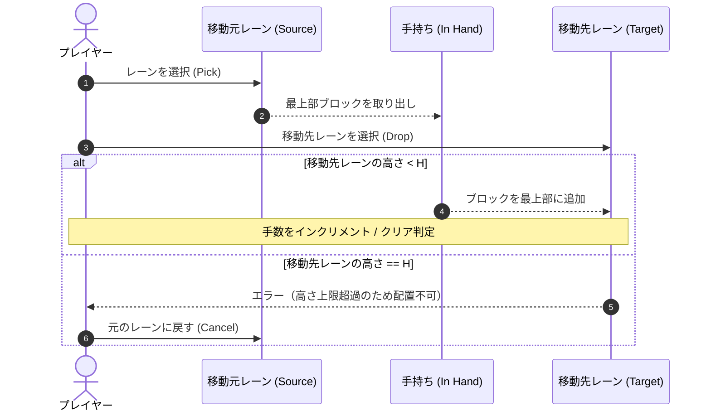
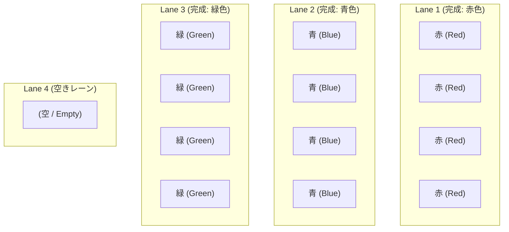
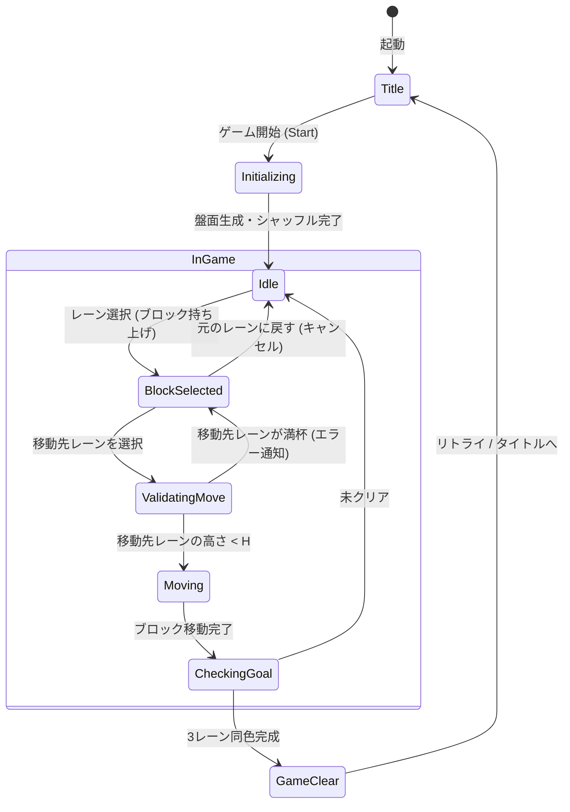

# 4レーン・ブロックソートパズル ゲーム詳細仕様書

## 1. ゲーム概要

### 1.1 ゲームコンセプト
本ゲームは、4つのレーンと3色のブロックを用いて、各色ごとにブロックを1つのレーンに集約して整理（ソート）する思考型パズルゲームです。
スタック（積み上げ）構造のレーン間でブロックを1つずつ移動させ、最終的に3つのレーンをそれぞれ単一色のブロックで満たすことを目指します。

### 1.2 コア要素
- **4つのレーン**: ブロックを積み上げるための縦型スロット（最大容量はすべて同一の $H$）。
- **3色のブロック**: 各色 $H$ 個ずつ、合計 $3H$ 個のブロックが存在。
- **1レーン分のバッファ**: 全レーンの総容量は $4H$ に対し、ブロック総数は $3H$ であるため、常に盤面全体で $H$ 個分の空き容量が存在し、パズルを解くための一時退避スペースとして機能します。

---

## 2. フィールド・オブジェクト仕様

### 2.1 レーン (Lane)
| 項目 | 仕様 |
| :--- | :--- |
| **レーン数** | 4本（Lane 1, Lane 2, Lane 3, Lane 4） |
| **高さ制限 ($H$)** | すべてのレーンで共通（初期推奨値: $H = 4$ または $5$） |
| **データ構造** | LIFO (Last-In, First-Out) スタック構造 |
| **総容量** | $4 \times H$ |

### 2.2 ブロック (Block)
| 項目 | 仕様 |
| :--- | :--- |
| **色数** | 3色（例: 赤 / Red, 青 / Blue, 緑 / Green） |
| **各色の個数** | 各色 $H$ 個（1レーンの高さ制限と同じ個数） |
| **ブロック総数** | $3 \times H$ 個 |
| **空き容量** | $4H - 3H = H$ 個分（常に1レーン相当の空きが存在） |



---

## 3. ゲームルール・操作仕様

### 3.1 初期配置 (Setup)
1. ゲーム開始時にランダムな「ソルト（シード文字列）」を発行します（既存のソルトを入力して過去盤面を再現することも可能）。
2. ソルトをシードとする確定的な擬似乱数生成器（PRNG）により、全 $3H$ 個のブロック（各色 $H$ 個）をシャッフルします。
3. 4つのレーンに対して、各レーンの高さ制限 $H$ を超えないようにブロックを分配配置します。
4. **初期配置の制約**:
   - 初期配置時点で既に勝利条件（いずれかの3レーンが単色で完成）を満たしているパターンは除外して再生成します。
   - すべてのレーンに最低1個以上のブロックが配置されるか、または空レーンが1つある状態など、ランダム分配アルゴリズムのパラメータにより調整可能です。

### 3.2 プレイヤーの操作 (Player Action)
プレイヤーは1手ごとに以下の操作を行います：
1. **持ち上げ (Pick / Select Source)**:
   - 任意のレーンを選択し、そのレーンの**最上部（Top）にあるブロック1つ**を持ち上げます。
   - ※ブロックが0個（空）のレーンからは持ち上げることはできません。
2. **移動先への配置 (Drop / Select Destination)**:
   - 持ち上げたブロックを、**別のレーンの最上部**へ移動させて配置します。
   - ※持ち上げた元のレーンに戻す操作は「キャンセル」として扱い、手数にはカウントしません。



### 3.3 移動制限・制約条件 (Constraints)
- **高さ制限の遵守**: 移動先レーンの現在のブロック数が高さ制限 $H$ に達している場合、そのレーンへブロックを移動することはできません。
- **色制限なし**: 一般的なカラーソートパズルと異なり、移動先レーンの最上部ブロックと色が異なっていても配置可能です（高さ制限のみが制約となります）。
- **1手1ブロック**: 一度に移動できるブロックは常に1個です。

---

## 4. 勝利条件 (Goal / Clear Condition)

### 4.1 ゴール状態
以下の条件がすべて満たされた瞬間にゲームクリアとなります：
1. **3つのレーンがそれぞれ同一色のブロックで完全に満たされていること**:
   - レーンA: 色1のブロックが $H$ 個積み上がっている
   - レーンB: 色2のブロックが $H$ 個積み上がっている
   - レーンC: 色3のブロックが $H$ 個積み上がっている
2. **残りの1レーンが完全に空（ブロック数 0）であること**（条件1が満たされれば、ブロック総数 $3H$ より自動的に成立します）。



---

## 5. ゲーム状態遷移



---

## 6. データモデル・内部表現

### 6.1 基本型定義 (例: TypeScriptライクなモデル表現)
```typescript
/** ブロックの色 */
type BlockColor = 'RED' | 'BLUE' | 'GREEN';

/** ブロックオブジェクト */
interface Block {
  id: string;
  color: BlockColor;
}

/** レーンのデータ構造 (最大要素数: H) */
type Lane = Block[];

/** ゲーム盤面全体の状態 */
interface GameState {
  salt: string;              // 盤面再現用ソルト（シード文字列）
  heightLimit: number;       // 高さ制限 H (例: 4)
  lanes: [Lane, Lane, Lane, Lane]; // 4つのレーン
  selectedLaneIndex: number | null; // 現在持ち上げ中の移動元レーン
  moveCount: number;         // プレイヤーの手数
  startTime: number;         // 開始タイムスタンプ
  isCleared: boolean;        // クリアフラグ
}
```

### 6.2 判定ロジック
- **移動可否判定 (`canMove(fromIndex, toIndex)`)**:
  - `fromIndex !== toIndex`
  - `lanes[fromIndex].length > 0`
  - `lanes[toIndex].length < heightLimit`
- **クリア判定 (`checkWinCondition(lanes, heightLimit)`)**:
  - 満杯（`length === heightLimit`）かつ全要素が同一色のレーンがちょうど3つ存在する。
  - 残り1つのレーンの要素数が 0 である。

---

## 7. 実装・設計における検討事項

1. **初期配置の生成アルゴリズムとソルト再現性**:
   - ゲーム開始時にランダムなソルト（英数字）を発行し、確定的なPRNG（Mulberry32等）を用いて盤面を生成します。同一ソルトを入力することで全く同じ初期配置が再現されます。
   - ※本ゲームは「異色ブロックの上にも配置可能」な仕様であるため、空きスペースが $H$ 個分確保されていれば、基本的に任意の配置から解へ到達可能（可解性：Solvable）です。
2. **操作性（UI/UX）とAPI抽象化**:
   - ゲームのコア操作をAPI（`pick`, `drop`, `move`, `cancel` 等）として分離・抽象化し、その上に「クリック/タップ」「ドラッグ＆ドロップ」「キーボード（1〜4キー等）」の各入力ラッパーを実装します。
   - 詳細は [システム・アーキテクチャ設計書 (doc/architecture.md)](file:///e:/Project/00-Game/4Lane%20Block/doc/architecture.md) を参照してください。
3. **難易度設定**:
   - レーンの高さ $H$ を 3（初級）、4（中級）、5（上級）と可変にする設計が容易に導入可能です。

